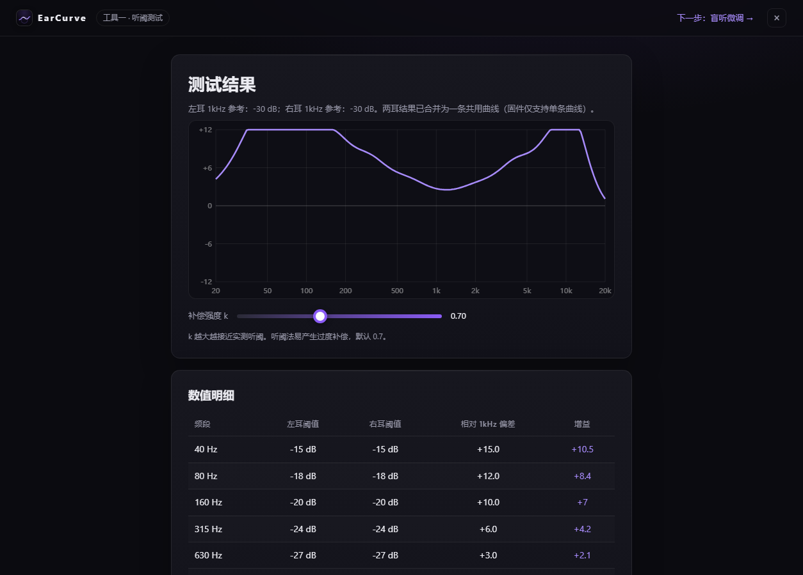
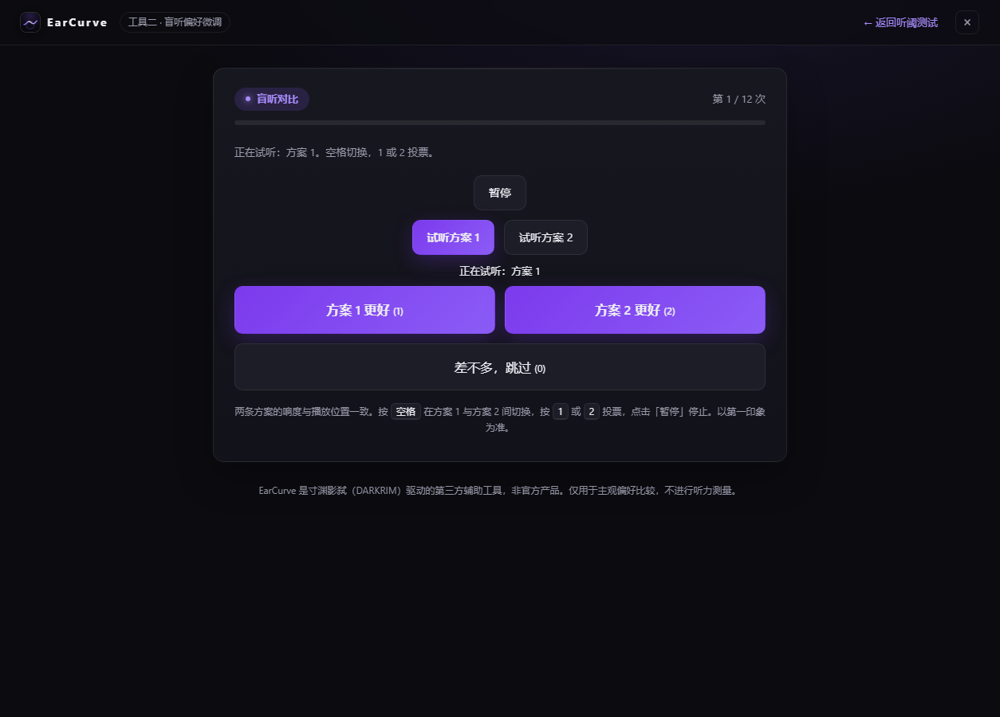
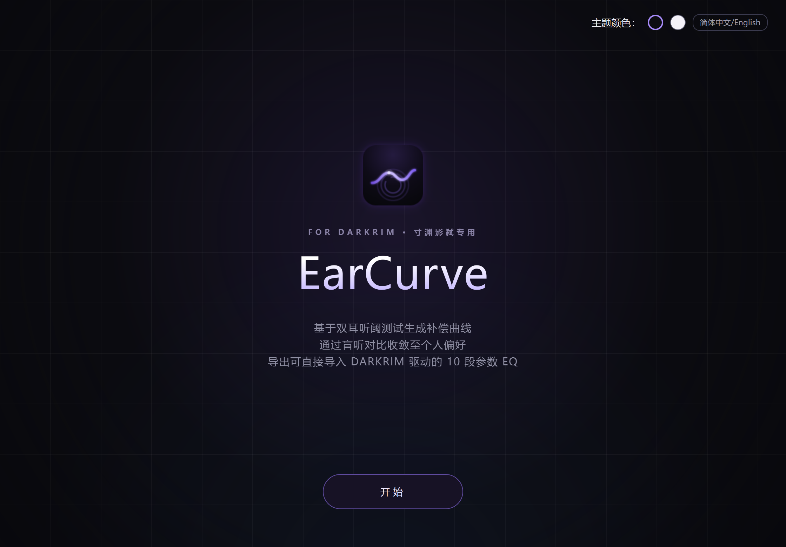
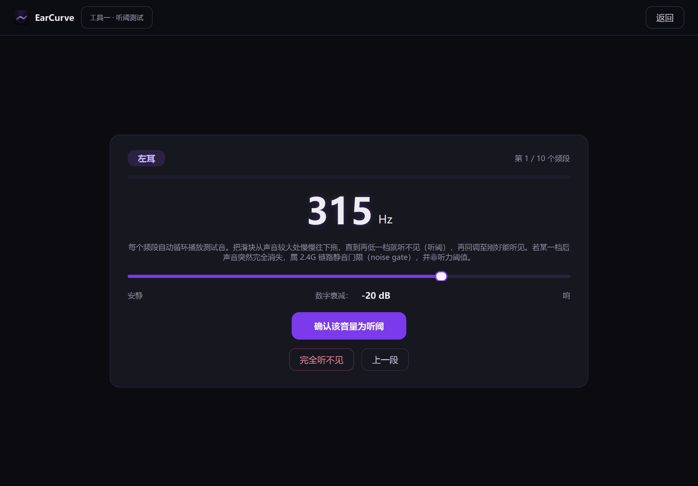
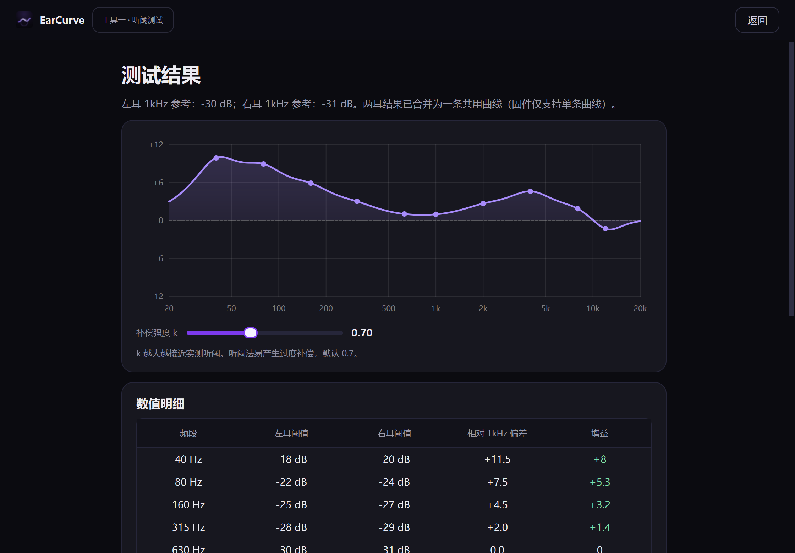
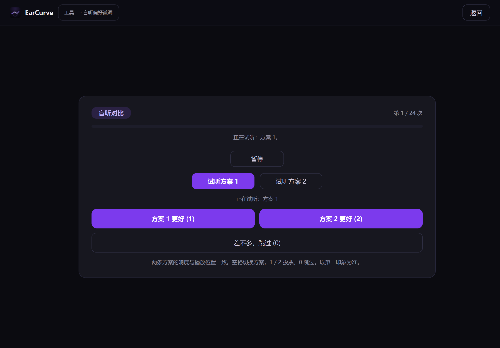
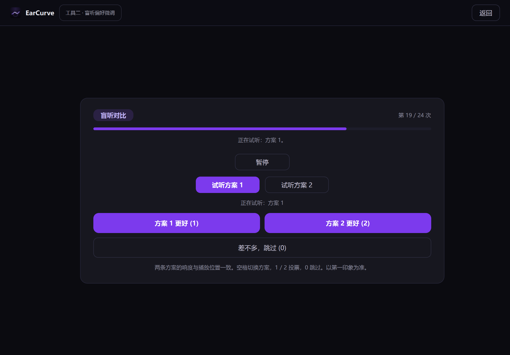

# EarCurve

[中文](#chinese) | [English](#english)


[](https://github.com/Realeek/EarCurve/actions/workflows/test.yml)

---

<a id="chinese"></a>

## 中文

### 寸渊影弑（DARKRIM SHADOW）耳机自定义 EQ 工具

EarCurve 是一款面向 **寸渊影弑（DARKRIM SHADOW）** 耳机的**自定义 EQ 工具**：通过分耳听阈测试生成补偿曲线，再用盲听 A/B 对比微调，最后导出可直接导入 DARKRIM 驱动的 10 段参数 EQ JSON。网页版纯静态、零依赖；桌面版离线运行，包含音频播放、盲听 A/B 与 8 首内置 CC0 试听曲库。

> 关键词：寸渊影弑耳机 EQ、寸渊影弑自定义 EQ、Darkrim Shadow custom EQ tool、DARKRIM SHADOW equalizer、10 段参数 EQ。

### 下载

优先使用 GitHub Releases 中的 Windows 成品：

- `EarCurve-DarkrimShadow-0.1.0-windows-x64.exe`：单文件便携版，首次启动会解压，约 55 MB。
- `EarCurve-DarkrimShadow-0.1.0-windows-x64-onedir.zip`：解压目录版，启动更快，约 134 MB。

下载地址：[Releases](https://github.com/Realeek/EarCurve/releases/latest)

网页版在线体验：[GitHub Pages](https://realeek.github.io/EarCurve/)

### 它做什么

- **工具一 · 分耳听阈测试**：逐耳、逐频段播放纯音，你调到「刚好能听见」，工具据此自动算出一条补偿曲线。左右耳分别测试，最后合并为一条共用曲线（耳机固件只支持一条）。
- **工具二 · 盲听偏好微调**：在两条等响度曲线之间盲选「哪条更好听」，20–30 次后曲线向你的口味收敛。可使用内置 CC0 曲库或本机音乐文件。
- **影视曲线**：一键生成一条低频和人声略加强、留了防削波余量的版本，配合空间音效看电影。
- **驱动导入**：输出与 DARKRIM 驱动导出格式一致的 JSON，直接「导入」即可；曲线名区分 `EarCurve-Music`、`EarCurve-Movie`、`EarCurve-Final`。

| 听阈测试 | 盲听微调 |
| --- | --- |
|  |  |

### 项目状态

- **网页版**在 `web/`：可直接双击运行，或通过 GitHub Pages 访问。
- **桌面版**在 `src/earcurve/`：开场动画、主题/语言切换、退出确认、分耳听阈测试、盲听偏好微调均已接入，可直接播放与导出。
- 内置 8 首 CC0 试听曲库（25 秒片段、128 kbps 立体声），可离线完成盲听，也可改选本机音乐文件夹。
- PyInstaller onefile / onedir 已实际构建并通过自检；干净 Python 3.12 环境下 onedir 约 134 MB、onefile 约 55 MB。

| 桌面版开场 | 桌面版主界面 |
| --- | --- |
|  |  |

| 桌面版听阈测试 | 桌面版结果 |
| --- | --- |
|  |  |

| 桌面版盲听准备 | 桌面版盲听对比 | 桌面版微调结果 |
| --- | --- | --- |
|  |  |  |

### 快速开始

#### 网页版

1. 用 **Edge / Chrome** 打开 `web/index.html`，或访问 GitHub Pages。
2. 按页面检查清单准备：驱动 EQ 全平直、关闭空间音效。
3. 完成分耳听阈测试，导出 `darkrim-eq-music.json`，在驱动「自定义 1」导入。
4. 跑盲听微调，导出 `darkrim-eq-final.json` 覆盖导入。
5. 驱动里上传云端，在手机 App 应用同一曲线。

#### 桌面版（成品）

1. 下载 Release 中的单文件版或 onedir 压缩包。
2. 解压 onedir 版后运行 `EarCurve.exe`；单文件版直接运行。
3. 首次使用建议先完成听阈测试，再进行盲听微调。

#### 桌面版（开发态）

```bash
pip install -r requirements.txt
pip install -e .
python -m earcurve            # 启动
python -m earcurve --smoke    # 无界面冒烟
python -m earcurve --self-test  # 载入内置曲库、渲染并检查音频设备
```

进入「分耳听阈测试」后，页面会自动播放当前频段的短促测试音。先在准备页用 1kHz 参考音设定舒适音量，完成后可导出音乐/影视曲线。进入「盲听偏好微调」后可直接使用内置 CC0 曲库，或选择本机音乐文件夹；工具随机抽取最多 8 首、各取中段片段，在两条等响度曲线间盲选。结果与进度会保存在 `%APPDATA%\EarCurve`。

#### 桌面版（打包）

建议用干净的 Python 3.12 环境构建。直接使用 Anaconda 基础环境会把 MKL、完整 PySide6 与大量无关 DLL 打进包内，体积约 550 MB；干净环境可降到约 134 MB（onedir）/ 55 MB（onefile）。

```bash
# 推荐：用 uv 创建一个干净的构建环境（也可用其他独立 Python 3.12）
uv venv --python 3.12 .venv-clean
uv pip install --python .venv-clean/Scripts/python.exe -r requirements.txt

# 用该环境构建
.venv-clean/Scripts/python.exe scripts/build_desktop.py
```

也可以不用 uv：用任意独立 CPython 3.12 创建 venv 后 `pip install -r requirements.txt`，再运行同样的命令。运行时依赖为 `PySide6-Essentials`，不需要完整的 PySide6 Addons / WebEngine。

```bash
python scripts/build_desktop.py            # onedir + onefile
python scripts/build_desktop.py --onedir   # 仅 onedir
python scripts/build_desktop.py --onefile  # 仅 onefile
python scripts/build_desktop.py --dist dist-clean --work build-clean
```

产物：

- `dist/EarCurve/EarCurve.exe`（onedir，约 134 MB，启动快）
- `dist/EarCurve.exe`（onefile，约 55 MB，单文件分发，首次启动需解压）

打包验证：

```bash
dist/EarCurve/EarCurve.exe --self-test
dist/EarCurve.exe --self-test
```

自检会载入 8 首内置曲库、渲染 1 秒片段并枚举音频输出设备，成功时输出 `self-test ok`。内置曲库、图标、`sounddevice` 的 PortAudio DLL 与 `soundfile` 的 libsndfile DLL 均已包含在包内。

### 兼容性

- **耳机/驱动**：专为寸渊影弑（DARKRIM SHADOW，2.4G 接收器）的驱动 JSON 格式设计。其他 10 段参数 EQ 设备只要 JSON 结构一致也能导入；结构不同的话改 `web/js/eq.js` 或桌面版 `src/earcurve/core/eq.py` 里的转换函数即可。
- **浏览器**：Chromium 内核（Edge / Chrome 110+）。需要 Web Audio、`OfflineAudioContext`、`webkitdirectory`。
- **平台**：Windows 10/11 x64（在 Windows 11 上开发与验证）。

#### 驱动 JSON 格式

```json
{
  "freq":   ["40", "80", "160", "315", "630", "1000", "2000", "4000", "8000", "12000"],
  "q":      ["1.00", "1.00", "1.00", "1.00", "1.00", "1.00", "1.00", "1.00", "1.00", "1.00"],
  "sound":  ["0", "0", "0", "0", "0", "0", "0", "0", "0", "0"],
  "type":   ["1", "1", "1", "1", "1", "1", "1", "1", "1", "1"],
  "main_gain": 0,
  "name": "EarCurve-Music"
}
```

除 `main_gain` 为数字外，其余字段均为字符串；`type` 固定 `"1"`（峰值滤波）；`q` 两位小数、增益一位小数。EarCurve 生成的曲线名分别为 `EarCurve-Music`、`EarCurve-Movie`、`EarCurve-Final`，导入驱动后可直接区分。导入前建议先「重置(官方默认EQ)」，避免旧曲线叠加。

### 测试前必须做的准备

#### 1. 驱动 EQ 必须是全平直

- 驱动里点「重置(官方默认EQ)」，确认白线压在 0 线上。
- 如果官方默认本身带调音（曲线不是直线），不要用它：新建一条自定义槽，10 段增益全部设 0、`main_gain = 0`，应用后再测。
- 听阈测试和盲听微调期间都保持全平直；只有导出最终 JSON 后才导入驱动。

#### 2. 关闭所有音效处理

电脑：

- Windows 设置 → 系统 → 声音 → 输出设备 → **空间音频：关**（DTS Sound Unbound / Windows Sonic）
- Realtek Audio Console 里的 **DTS Audio Processing / 音效增强：关**
- QQ 音乐 / 网易云等播放器自带音效：关

手机（验证一致性和日常听歌时）：

- 设置 → 声音与振动 → **声音效果（Dolby Atmos）：关**
- 小米「耳机音效」：关
- 音乐 App 内音效：关

原因：这些处理本身就是 EQ + 动态压缩。开着它们测，测到的是「耳机 + 音效」的联合响应，补偿会失真。

#### 3. 其他

- 环境安静，耳机正常佩戴（L 完全罩住左耳），测试中不要移动。
- 参考音按测试音的最大电平播放：用它把系统音量调到**中等、舒适**的水平，这就是全程上限。音量过小容易听不到高频，音量过大容易提前触发 2.4G 静音门限。
- 2.4G 模式下 LHDC 无关，不用管。
- 听力保护：全程舒适音量，任何不适立即停止。

### 工具一：听阈测试

- 左右耳各 10 个频段：40 / 80 / 160 / 315 / 630 / 1k / 2k / 4k / 8k / 12k Hz，顺序随机。
- 每个频段：播放纯音 → 滑块从响到轻拖到「再小一点就听不见」→ 回调到刚能听见 → 确认 → 用同一音量复听一次确认。
- **静音门限**：部分 2.4G 接收器在很低的数字电平处有 noise gate，表现为「某一档突然完全无声」。遇到时请在**最后一档仍有声的位置确认**（这是阈值的保守上界）；只有真的完全听不到才选「完全听不见」。工具会在接近门限时提示。
- 结果计算：
  - 以 1kHz 为参考，`gain = clamp(k · (L_i − L_1k), ±12)`，`k` 默认 **0.7**（听阈法容易过度补偿，可调 0.5–1.0）。
  - 左右耳结果取平均，合并为一条共用曲线；`main_gain` 自动留防削波余量。
- 导出：
  - `darkrim-eq-music.json`（`EarCurve-Music`）→ 自定义 1，日常听歌。
  - `darkrim-eq-movie.json`（`EarCurve-Movie`）→ 自定义 2，看电影开空间音效时用。

### 工具二：盲听微调

- 开始前：**驱动 EQ 必须保持全平直**，不要先导入听阈曲线；DTS/Dolby 等音效关闭。A/B 曲线由程序渲染，驱动若挂着听阈曲线会叠加两层 EQ。
- 系统音量调到适合盲听的舒适音量即可，不必沿用听阈测试时的音量；开始比较后保持该音量不变。
- 使用内置 CC0 曲库，或选择任意包含 mp3/flac/wav 的文件夹；桌面版随机抽取最多 8 首、各截取中段片段，只在本机内存中解码，不上传。
- 每次比较：随机扰动 1 个频段 ±1–3 dB 生成挑战曲线；两条曲线各自离线渲染同一片段，RMS 响度对齐后**同步播放**。
- 用**空格**或「试听方案 1 / 2」按钮在两条曲线间无缝切换（同一位置、同一响度），听完再选「方案 1 / 方案 2 / 差不多」。
- 24 次约 12–16 分钟。结束后导出 `darkrim-eq-final.json`（`EarCurve-Final`）；可「再来一轮」继续收敛。

### 常见问题

**为什么某一档还有声音，再低一档就突然完全没了？**
2.4G 接收器/耳机固件里的静音门限（noise gate），不是听力问题。请在最后一档仍有声的位置确认；工具会显示提示。

**导入后没变化？**
确认导入的是当前选中的自定义槽位，且云端/手机端应用的是同一条曲线；确认 DTS 等音效状态与测试时一致。

**桌面版没有声音？**
听阈测试可在准备页「输出设备」里选择耳机对应的 WASAPI 设备；若列表里没有，先把耳机设为 Windows 默认输出再重新进入页面。盲听微调使用系统默认输出。开始测试时若无法打开音频设备，程序会给出提示，不会进入无声测试。

**桌面版盲听支持哪些音乐格式？**
mp3、flac、wav、ogg（含 aiff）。m4a/aac 依赖系统解码器，桌面版暂不支持，请先转换为 mp3/flac。文件夹只扫描一层，不递归子目录。

**内置曲库有版权限制吗？**
8 段试听音频均为 CC0 1.0（公共领域），可自由使用与再分发。来源、作者和原始文件见 [assets/tracks/CREDITS.md](assets/tracks/CREDITS.md)。

**浏览器没有声音 / 没有声音输出选择？**
先点页面上的播放按钮（浏览器要求用户手势才能启动音频）；输出设备下拉若无效，请在 Windows 声音设置里把耳机设为默认输出。

**测试到一半刷新或关掉了？**
网页版进度保存在 localStorage；桌面版保存在 `%APPDATA%\EarCurve\hearing-progress.json`。准备页会出现「继续上次（左耳第 N 段）」；完成过的结果可点「查看上次结果」。

**曲线看起来和驱动里不完全一样？**
浏览器用 RBJ peaking 近似驱动的 type=1 滤波，Q 语义可能有细微差异；以导入驱动后的实听为准。

**手机和电脑听感不同？**
先确认两端音效（DTS / Dolby）都关闭；手机蓝牙的编解码与 2.4G 链路本身也有差异，属于正常范围。

**觉得低频不够 / 高频刺？**
跑盲听微调，它直接优化「你觉得好听」，比手动猜更可靠。

### 项目结构

```
.
├─ web/                    网页版
│  ├─ index.html           入口 / 开场与主题、语言切换
│  ├─ hearing-test.html    工具一：分耳听阈测试
│  ├─ ab-tuner.html        工具二：盲听偏好微调
│  ├─ css/style.css
│  └─ js/                  eq.js / audio-engine.js / theme.js / i18n.js / exit-guard.js
├─ src/earcurve/           桌面版（PySide6）
│  ├─ app.py               应用入口
│  ├─ main_window.py       窗口、导航、退出确认
│  ├─ ui.py                开场页 / 主界面 / 占位页
│  ├─ hearing_page.py      工具一：分耳听阈测试界面
│  ├─ tuning_page.py       工具二：盲听偏好微调界面
│  ├─ widgets.py           频响曲线图 / 滚动容器
│  ├─ theme.py             深色 / 浅色 QSS
│  ├─ i18n.py              中英文案
│  ├─ paths.py             资源与用户数据路径
│  ├─ audio/tone.py        测试音合成与输出（sounddevice）
│  ├─ audio/dsp.py         片段解码、FFT 频响渲染、响度对齐
│  ├─ audio/pair.py        两条曲线同步播放与无缝切换
│  └─ core/                EQ 模型、听阈计算与盲听状态
├─ assets/                 图标源文件与生成尺寸（含 icon.ico）
│  └─ tracks/              内置 CC0 曲库（8 首 25 s / 128 kbps）+ 清单与 credits
├─ scripts/
│  ├─ gen_icons.py         图标尺寸生成
│  ├─ prepare_tracks.py    内置曲库剪辑 / 响度归一化 / 编码
│  └─ build_desktop.py     PyInstaller onefile / onedir
├─ test/
│  ├─ eq.test.js           网页版纯逻辑测试
│  ├─ test_core_eq.py      桌面版 EQ 核心测试
│  ├─ test_core_hearing.py 桌面版听阈计算测试
│  ├─ test_core_tuning.py  桌面版盲听状态测试
│  ├─ test_audio_dsp.py    桌面版离线渲染测试
│  ├─ test_tracks.py       内置曲库完整性测试
│  └─ test_desktop.py      桌面版窗口冒烟
├─ run_earcurve.py         PyInstaller / 开发入口
├─ pyproject.toml
├─ requirements.txt
└─ docs/screenshots/       README 截图
```

### 开发

```bash
node test/eq.test.js             # 网页版逻辑测试
python -m pytest test -q         # 桌面版核心 + 窗口冒烟（需 PySide6）
python scripts/gen_icons.py      # 生成图标尺寸与 icon.ico
python scripts/prepare_tracks.py --source <下载的 FreePD 源目录>  # 重新生成内置曲库
python scripts/build_desktop.py  # 打包 onefile + onedir
```

桌面版音频使用 `sounddevice`（PortAudio）输出，盲听素材由 `soundfile` 解码。测试页若无法打开输出设备会给出提示；盲听支持 mp3 / flac / wav / ogg，m4a/aac 需要额外解码器，桌面版暂不支持。测试音以数字衰减记录，不依赖声压校准。

- 网页版无 npm 依赖、无构建步骤；`package.json` 只提供 `npm test` 别名。
- 浏览器端到端验证：用 Edge 打开 `web/hearing-test.html` 走完一次测试、导入驱动检查曲线；再打开 `web/ab-tuner.html` 载入音乐跑几个 trial。
- 修改频点、增益、k 值等常量时，同步更新网页版与桌面版。
- 桌面版开发态可用 `python -m earcurve --smoke` 在无界面环境验证启动。

### 隐私

- 不发起任何网络请求；音频文件只在本地内存中解码。
- 网页版进度保存在 localStorage；桌面版设置保存在 `%APPDATA%\EarCurve`。
- 仓库内不包含任何用户音频或测量数据。

### 免责声明

EarCurve 是为寸渊影弑（DARKRIM SHADOW）驱动开发的第三方辅助工具，与 DARKRIM 品牌方无关，非官方产品。工具仅用于个人听感调整，不是医疗设备，不能用于听力诊断。使用任何 EQ 或高音量播放造成的风险由使用者自行承担。

### 内置曲库与素材许可

- `assets/tracks/` 中的 8 段试听音频来自 FreePD 公共领域曲库，以 **CC0 1.0** 释出；已做 25 秒剪辑、响度归一化、淡入淡出与 128 kbps 立体声重编码。完整来源、作者与原始文件名见 [assets/tracks/CREDITS.md](assets/tracks/CREDITS.md)，许可原文见 [assets/tracks/CC0-1.0.txt](assets/tracks/CC0-1.0.txt)。
- 曲目清单与时长/码率信息见 [assets/tracks/manifest.json](assets/tracks/manifest.json)。
- 应用代码、图标与文档以 MIT 释出；内置曲库仍为 CC0，不受 MIT 限制。

### License

代码与文档：[MIT](LICENSE)。内置曲库：[CC0 1.0](assets/tracks/CC0-1.0.txt)。

---

<a id="english"></a>

## English

### Custom EQ tool for the Darkrim Shadow (寸渊影弑) headphone

EarCurve is a **Darkrim Shadow (寸渊影弑) custom EQ tool**: it measures per-ear hearing thresholds, builds a compensation curve, refines it through blind A/B comparisons, and exports a 10-band parametric EQ JSON that the DARKRIM driver can import. The web app is static and dependency-free; the desktop app runs fully offline with audio playback, blind A/B tuning, and eight bundled CC0 sample tracks.

> Keywords: Darkrim Shadow custom EQ tool, DARKRIM SHADOW equalizer, 寸渊影弑 EQ, 寸渊影弑耳机自定义 EQ, 10-band parametric EQ.

### Download

Use the Windows builds from GitHub Releases:

- `EarCurve-DarkrimShadow-0.1.0-windows-x64.exe`: portable single-file build, extracted on first launch, about 55 MB.
- `EarCurve-DarkrimShadow-0.1.0-windows-x64-onedir.zip`: unpacked folder build, faster startup, about 134 MB.

Downloads: [Releases](https://github.com/Realeek/EarCurve/releases/latest)

Web demo: [GitHub Pages](https://realeek.github.io/EarCurve/)

### What it does

- **Tool 1 · Per-ear hearing test**: plays a tone band by band for each ear; you set it to “just audible”, and the tool calculates a compensation curve. Left and right results are merged into one shared curve because the firmware supports only one.
- **Tool 2 · Blind preference tuning**: blindly compares two loudness-matched curves with the same excerpt and playback position. After 20–30 comparisons the curve converges toward your preference. Use the bundled CC0 library or your own music folder.
- **Movie curve**: generates a version with slight bass and vocal lift plus anti-clipping headroom for movies with spatial audio.
- **Driver import**: exports a JSON matching the DARKRIM driver format; curve names distinguish `EarCurve-Music`, `EarCurve-Movie`, and `EarCurve-Final`.

| Hearing test | Blind tuning |
| --- | --- |
|  |  |

### Project status

- **Web app** in `web/`: open directly or use GitHub Pages.
- **Desktop app** in `src/earcurve/`: intro animation, theme/language switching, exit confirmation, per-ear hearing test, and blind tuning are implemented.
- Eight CC0 sample tracks (25 s, 128 kbps stereo) are bundled for fully offline tuning; local music folders are also supported.
- PyInstaller onefile/onedir builds are verified: about 134 MB for onedir and 55 MB for onefile in a clean Python 3.12 environment.

| Desktop intro | Desktop home |
| --- | --- |
|  |  |

| Desktop hearing test | Desktop results |
| --- | --- |
|  |  |

| Desktop tuning setup | Desktop blind comparison | Desktop tuning results |
| --- | --- | --- |
|  |  |  |

### Quick start

#### Web app

1. Open `web/index.html` in **Edge / Chrome**, or use GitHub Pages.
2. Follow the checklist: driver EQ flat, spatial audio disabled.
3. Complete the per-ear hearing test, export `darkrim-eq-music.json`, and import it into driver “Custom 1”.
4. Run blind tuning, export `darkrim-eq-final.json`, and import it over Custom 1.
5. Upload the curve to the cloud from the driver and apply it in the phone app.

#### Desktop app (release build)

1. Download the single-file build or the onedir zip from Releases.
2. Run `EarCurve.exe`; for onedir, unzip first.
3. For best results, complete the hearing test before blind tuning.

#### Desktop app (development)

```bash
pip install -r requirements.txt
pip install -e .
python -m earcurve            # launch
python -m earcurve --smoke    # headless smoke test
python -m earcurve --self-test  # load bundled tracks, render, check audio devices
```

The hearing test starts the burst tone automatically. Use the 1 kHz reference on the preparation page to set a comfortable volume, then export the music/movie curves. Blind tuning can use the bundled CC0 library or a local music folder; up to eight tracks are sampled and a middle segment is extracted from each. Results and progress are stored under `%APPDATA%\EarCurve`.

#### Desktop app (packaging)

Use a clean Python 3.12 environment. Building inside an Anaconda base environment bundles MKL and a full PySide6 install, producing about 550 MB; the clean build is about 134 MB for onedir and 55 MB for onefile.

```bash
# Recommended: create a clean build environment with uv
uv venv --python 3.12 .venv-clean
uv pip install --python .venv-clean/Scripts/python.exe -r requirements.txt

# Build with that environment
.venv-clean/Scripts/python.exe scripts/build_desktop.py
```

Without uv, create a venv from any standalone CPython 3.12, install `requirements.txt`, and run the same command. Runtime dependencies use `PySide6-Essentials`, so the full PySide6 Addons/WebEngine are not required.

```bash
python scripts/build_desktop.py            # onedir + onefile
python scripts/build_desktop.py --onedir   # onedir only
python scripts/build_desktop.py --onefile  # onefile only
python scripts/build_desktop.py --dist dist-clean --work build-clean
```

Outputs:

- `dist/EarCurve/EarCurve.exe` (onedir, about 134 MB, fast startup)
- `dist/EarCurve.exe` (onefile, about 55 MB, extracted on first launch)

Verify:

```bash
dist/EarCurve/EarCurve.exe --self-test
dist/EarCurve.exe --self-test
```

The self-test loads the eight bundled tracks, renders a one-second clip, and enumerates audio output devices; success prints `self-test ok`. The tracks, icon, sounddevice PortAudio DLL, and soundfile libsndfile DLL are all bundled.

### Compatibility

- **Headphones/driver**: designed for the Darkrim Shadow (DARKRIM SHADOW, 2.4G receiver) driver JSON format. Other 10-band parametric EQ devices can import it if the JSON structure matches; otherwise adapt `web/js/eq.js` or `src/earcurve/core/eq.py`.
- **Browser**: Chromium-based (Edge / Chrome 110+) with Web Audio, `OfflineAudioContext`, and `webkitdirectory`.
- **Platform**: Windows 10/11 x64 (developed and verified on Windows 11).

#### Driver JSON format

```json
{
  "freq":   ["40", "80", "160", "315", "630", "1000", "2000", "4000", "8000", "12000"],
  "q":      ["1.00", "1.00", "1.00", "1.00", "1.00", "1.00", "1.00", "1.00", "1.00", "1.00"],
  "sound":  ["0", "0", "0", "0", "0", "0", "0", "0", "0", "0"],
  "type":   ["1", "1", "1", "1", "1", "1", "1", "1", "1", "1"],
  "main_gain": 0,
  "name": "EarCurve-Music"
}
```

Every field except `main_gain` is a string; `type` is always `"1"` (peaking filter); `q` uses two decimals and gain one decimal. EarCurve uses the curve names `EarCurve-Music`, `EarCurve-Movie`, and `EarCurve-Final` so imported curves are easy to distinguish. Reset the driver to the official default EQ before importing to avoid stacking curves.

### Preparation

#### 1. Driver EQ must be flat

- Click “Reset (factory default EQ)” and confirm the white line sits on 0 dB.
- If the factory default is tuned, do not use it: create a custom slot with all 10 gains at 0 and `main_gain = 0`, apply it, then test.
- Keep the driver flat during both the hearing test and blind tuning; import the final JSON only after tuning.

#### 2. Disable all audio processing

PC:

- Windows Settings → System → Sound → Output → **Spatial audio: Off** (DTS Sound Unbound / Windows Sonic)
- Realtek Audio Console: **DTS Audio Processing / enhancements: Off**
- Player effects in QQ Music / NetEase Cloud Music: Off

Phone (for consistency checks and daily listening):

- Settings → Sound & vibration → **Sound effects (Dolby Atmos): Off**
- Xiaomi “Headphone effects”: Off
- In-app music effects: Off

These features are EQ plus dynamic compression. Measuring with them enabled captures the combined response of headphones and effects, which distorts the compensation.

#### 3. Other

- Quiet room, proper fit (L over the left ear), and no movement during the test.
- The reference tone plays at the test-tone maximum. Use it to set a **medium, comfortable** system volume; this is the ceiling for the session. Too quiet hides high frequencies; too loud can trigger the 2.4G noise gate early.
- LHDC is irrelevant in 2.4G mode.
- Hearing safety: use a comfortable volume and stop immediately if you feel discomfort.

### Tool 1: Hearing test

- Ten bands per ear: 40 / 80 / 160 / 315 / 630 / 1k / 2k / 4k / 8k / 12k Hz, in random order.
- Each band: play a tone → drag the slider down until one step lower is inaudible → return to just audible → confirm → listen again at the same level.
- **Noise gate**: some 2.4G receivers cut off abruptly at very low digital levels. Confirm at the **last step that is still audible** (a conservative upper bound); choose “Completely inaudible” only if you truly hear nothing. The tool warns near the gate.
- Calculation:
  - Reference at 1 kHz: `gain = clamp(k · (L_i − L_1k), ±12)`, with `k = 0.7` by default (adjustable 0.5–1.0 because threshold-based EQ tends to overcorrect).
  - Average both ears into one shared curve; `main_gain` reserves anti-clipping headroom.
- Export:
  - `darkrim-eq-music.json` (`EarCurve-Music`) → Custom 1 for daily listening.
  - `darkrim-eq-movie.json` (`EarCurve-Movie`) → Custom 2 for movies with spatial audio.

### Tool 2: Blind tuning

- Before starting: **keep the driver EQ flat** and do not import the hearing curve yet; disable DTS/Dolby and player effects. The A/B curves are rendered by the app; a driver curve would stack a second EQ.
- Set a comfortable system volume for blind listening; it does not need to match the hearing test, but keep it fixed once comparisons begin.
- Use the bundled CC0 library or any folder containing mp3/flac/wav; the desktop app samples up to eight tracks and extracts middle segments, all decoded locally in memory.
- Each comparison nudges one band by ±1–3 dB, renders both curves for the same excerpt, matches RMS loudness, and plays them **synchronously**.
- Press **Space** or use “Preview 1 / 2” to switch between the same position and loudness; then choose “Option 1 / Option 2 / About the same”.
- 24 comparisons take about 12–16 minutes. Export `darkrim-eq-final.json` (`EarCurve-Final`); “Run another round” continues from the current curve.

### FAQ

**Why does one step still have sound, then the next is completely silent?**
That is the 2.4G receiver/firmware noise gate, not your hearing. Confirm at the last audible step; the tool displays a warning.

**Nothing changed after importing?**
Make sure you imported into the selected custom slot and applied the same curve in the cloud/phone app; also check that DTS and other effects match the test conditions.

**No sound in the desktop app?**
In the hearing test, select the headphone’s WASAPI device on the preparation page. If it is missing, set the headphones as the Windows default output and reopen the page. Blind tuning uses the system default output. If the audio device cannot be opened, the app reports an error instead of starting a silent test.

**Which formats does desktop blind tuning support?**
mp3, flac, wav, and ogg (including aiff). m4a/aac requires an extra decoder and is not supported on desktop; convert to mp3/flac first. Only the selected folder is scanned, not subfolders.

**Are the bundled tracks copyrighted?**
All eight excerpts are CC0 1.0 (public domain) and may be reused and redistributed. See [assets/tracks/CREDITS.md](assets/tracks/CREDITS.md).

**No sound in the browser / no output selector?**
Click the play button first (browsers require a user gesture to start audio). If the output selector does not work, set the headphones as the Windows default output.

**What if I refresh or close mid-test?**
Web progress is stored in localStorage; desktop progress is stored in `%APPDATA%\EarCurve\hearing-progress.json`. The preparation page offers “Resume last test”, and completed results can be reopened.

**The curve looks slightly different in the driver?**
The browser approximates the driver’s type=1 filter with an RBJ peaking filter, so Q semantics may differ slightly. Trust your ears after importing.

**Why do PC and phone sound different?**
Disable spatial/phone effects on both sides first; Bluetooth codecs and the 2.4G link also differ, which is normal.

**Too little bass / harsh treble?**
Run blind tuning; it optimizes what sounds good to you rather than relying on manual guesses.

### Project structure

```
.
├─ web/                    Web app
│  ├─ index.html           Entry / intro, theme and language switching
│  ├─ hearing-test.html    Tool 1: per-ear hearing test
│  ├─ ab-tuner.html        Tool 2: blind preference tuning
│  ├─ css/style.css
│  └─ js/                  eq.js / audio-engine.js / theme.js / i18n.js / exit-guard.js
├─ src/earcurve/           Desktop app (PySide6)
│  ├─ app.py               Entry point
│  ├─ main_window.py       Window, navigation, exit confirmation
│  ├─ ui.py                Intro / home / placeholder pages
│  ├─ hearing_page.py      Tool 1 UI
│  ├─ tuning_page.py       Tool 2 UI
│  ├─ widgets.py           Response chart / centered scroll container
│  ├─ theme.py             Dark / light QSS
│  ├─ i18n.py              Chinese / English strings
│  ├─ paths.py             Asset and user-data paths
│  ├─ audio/tone.py        Test-tone synthesis and output (sounddevice)
│  ├─ audio/dsp.py         Decoding, FFT EQ rendering, loudness matching
│  ├─ audio/pair.py        Synchronized A/B playback and switching
│  └─ core/                EQ model, hearing math, tuning state
├─ assets/                 Icon sources and generated sizes (including icon.ico)
│  └─ tracks/              Bundled CC0 library (8 × 25 s / 128 kbps) + manifest/credits
├─ scripts/
│  ├─ gen_icons.py         Icon size generation
│  ├─ prepare_tracks.py    Trim / normalize / encode bundled tracks
│  └─ build_desktop.py     PyInstaller onefile / onedir
├─ test/
│  ├─ eq.test.js           Web logic tests
│  ├─ test_core_eq.py      Desktop EQ core tests
│  ├─ test_core_hearing.py Desktop hearing math tests
│  ├─ test_core_tuning.py  Desktop tuning state tests
│  ├─ test_audio_dsp.py    Desktop offline rendering tests
│  ├─ test_tracks.py       Bundled library integrity tests
│  └─ test_desktop.py      Desktop window smoke test
├─ run_earcurve.py         PyInstaller / development entry
├─ pyproject.toml
├─ requirements.txt
└─ docs/screenshots/       README screenshots
```

### Development

```bash
node test/eq.test.js             # web logic tests
python -m pytest test -q         # desktop core + window smoke (PySide6 required)
python scripts/gen_icons.py      # generate icon sizes and icon.ico
python scripts/prepare_tracks.py --source <downloaded FreePD source folder>
python scripts/build_desktop.py  # build onefile + onedir
```

Desktop audio uses `sounddevice` (PortAudio) for output and `soundfile` for decoding. If no output device opens, the test page reports it; blind tuning supports mp3/flac/wav/ogg (m4a/aac needs an extra decoder). Test levels are recorded as digital attenuation and do not depend on absolute SPL calibration.

- The web app has no npm dependencies or build step; `package.json` only provides an `npm test` alias.
- Browser end-to-end check: open `web/hearing-test.html` in Edge, complete a test, import into the driver and compare the curve; then open `web/ab-tuner.html` and run a few trials.
- When changing bands, gains, or `k`, update both the web and desktop implementations.
- For a quick desktop launch check, run `python -m earcurve --smoke`.

### Privacy

- No network requests; audio files are decoded in local memory only.
- Web progress is stored in localStorage; desktop settings live under `%APPDATA%\EarCurve`.
- The repository contains no user audio or measurement data.

### Disclaimer

EarCurve is an unofficial companion tool for the Darkrim Shadow (DARKRIM SHADOW) driver and is not affiliated with the brand. It is for personal listening adjustment only, not a medical device, and must not be used for hearing diagnosis. You assume all risks from EQ use or high-volume playback.

### Bundled library and asset licenses

- The eight excerpts in `assets/tracks/` come from the FreePD public-domain catalog and are released under **CC0 1.0**. They were trimmed to 25 seconds, loudness-normalized, faded, and re-encoded at 128 kbps stereo. Sources, artists, and original filenames are listed in [assets/tracks/CREDITS.md](assets/tracks/CREDITS.md); the license text is in [assets/tracks/CC0-1.0.txt](assets/tracks/CC0-1.0.txt).
- Track durations and bitrates are listed in [assets/tracks/manifest.json](assets/tracks/manifest.json).
- Application code, icons, and documentation are MIT-licensed; the bundled tracks remain CC0 and are not restricted by MIT.

### License

Code and documentation: [MIT](LICENSE). Bundled tracks: [CC0 1.0](assets/tracks/CC0-1.0.txt).
